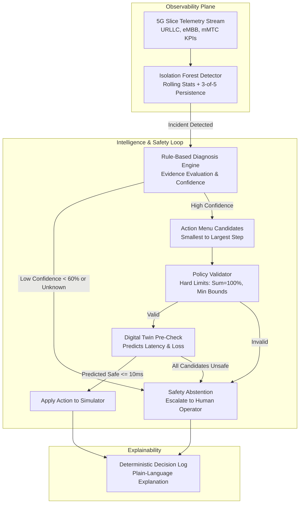

# SliceGuard-Lite: Safety-First Autonomous 5G Network Slice Assurance

> **Autonomous networks need AI that proves an action is safe before it acts.**

SliceGuard-Lite is a simulation-based prototype of autonomous assurance for 5G network slices. It monitors per-second slice telemetry, detects abnormal behavior using an unsupervised Isolation Forest, diagnoses the likely root cause with an explainable confidence score, validates candidate actions against hard policy invariants, pre-checks actions on an independent predictive Digital Twin, applies the intervention only if the critical slice is predicted to satisfy its SLA, and safely abstains and escalates to human operators when uncertain.

*A student prototype developed for the Nokia Shark Tank (AI in Telecom) selection at RV University. Runs 100% locally with free, open-source Python tools.*

---

## Key Architecture & Safety Principles



### Core Safety Pillars:
1. **The LLM Never Controls the Network**: All network operations originate from a fixed, strongly-typed action menu (`protect_urllc`, `rate_limit_embb`, `isolate_suspicious_traffic`, `scale_up_resource`, `escalate_to_human`, `no_action`).
2. **Ground-Truth Shielding**: Detectors and diagnostic engines monitor observable telemetry only, with zero access to evaluation-only scenario labels.
3. **Deterministic Policy Invariants**: Hard limits (capacity sum $= 100.0\%$, URLLC $\in [25\%, 50\%]$, eMBB $\ge 20\%$, mMTC $\ge 10\%$, max step $\le 15\%$) prevent illegal network states.
4. **Predictive Digital Twin Pre-Check**: Candidate actions are pre-tested on an approximate ML model trained with parameter perturbations ($\pm 15\%$ base latency, $\pm 15\%$ coupling $\gamma$, extra noise) to guarantee SLA restoration prior to execution.
5. **Safety Abstention**: When confidence is below $60\%$ or novel anomalies occur (e.g. unseen IoT registration storms), the system safely abstains and alerts humans.

---

## Benchmark Evaluation Results (30 Independent Seeds)

Empirical multi-seed results comparing **B1** (No Action), **B2** (Static Threshold), **B3** (Detector + Rules), and **B4** (Full Safety Loop) from [results/summary.csv](file:///home/maurya/Downloads/sliceguard-antigravity/results/summary.csv):

| Scenario | Controller | Mean URLLC Latency (ms) | Mean URLLC Loss (%) | SLA Violation Ticks | eMBB Throughput Lost (%) | Abstention Rate (%) |
|---|---|---|---|---|---|---|
| **eMBB Surge** | B1: No Action | $29.97 \pm 0.09$ | $4.19 \pm 0.01$ | $237.5 \pm 0.5$ | $13.7\%$ | $0.0\%$ |
| | B2: Static Threshold | $6.58 \pm 0.02$ | $0.10 \pm 0.00$ | $1.0 \pm 0.0$ | $27.5\%$ | $0.0\%$ |
| | B3: Detector Rules | $9.23 \pm 0.13$ | $0.36 \pm 0.00$ | $63.8 \pm 1.0$ | $21.1\%$ | $0.0\%$ |
| | **B4: Full Safety Loop** | $\mathbf{7.60 \pm 0.98}$ | $\mathbf{0.45 \pm 0.16}$ | $\mathbf{22.6 \pm 9.4}$ | $33.8\%$ | $0.5\%$ |
| **DDoS Attack** | B1: No Action | $31.41 \pm 0.09$ | $4.46 \pm 0.01$ | $250.0 \pm 0.0$ | $16.7\%$ | $0.0\%$ |
| | B2: Static Threshold | $6.66 \pm 0.02$ | $0.12 \pm 0.00$ | $1.0 \pm 0.0$ | $30.5\%$ | $0.0\%$ |
| | B3: Detector Rules | $7.38 \pm 0.03$ | $0.33 \pm 0.00$ | $23.0 \pm 0.0$ | $49.7\%$ | $0.0\%$ |
| | **B4: Full Safety Loop** | $\mathbf{8.37 \pm 0.11}$ | $\mathbf{0.50 \pm 0.02}$ | $\mathbf{23.2 \pm 1.1}$ | $50.5\%$ | $0.5\%$ |
| **Flash Crowd** | B1: No Action | $25.71 \pm 0.06$ | $3.42 \pm 0.01$ | $199.9 \pm 0.6$ | $6.2\%$ | $0.0\%$ |
| | B2: Static Threshold | $6.53 \pm 0.02$ | $0.10 \pm 0.00$ | $1.0 \pm 0.0$ | $19.5\%$ | $0.0\%$ |
| | B3: Detector Rules | $9.69 \pm 0.03$ | $0.10 \pm 0.00$ | $174.0 \pm 5.1$ | $12.7\%$ | $0.0\%$ |
| | **B4: Full Safety Loop** | $\mathbf{9.15 \pm 1.92}$ | $\mathbf{0.34 \pm 0.03}$ | $\mathbf{71.8 \pm 62.8}$ | $18.8\%$ | $0.3\%$ |
| **Unseen IoT Storm**| B1: No Action | $6.01 \pm 0.02$ | $0.10 \pm 0.00$ | $0.0 \pm 0.0$ | $0.2\%$ | $0.0\%$ |
| | B2: Static Threshold | $6.01 \pm 0.02$ | $0.10 \pm 0.00$ | $0.0 \pm 0.0$ | $0.2\%$ | $0.0\%$ |
| | B3: Detector Rules | $6.01 \pm 0.02$ | $0.10 \pm 0.00$ | $0.0 \pm 0.0$ | $0.2\%$ | $0.0\%$ |
| | **B4: Full Safety Loop** | $\mathbf{6.01 \pm 0.02}$ | $\mathbf{0.10 \pm 0.00}$ | $\mathbf{0.0 \pm 0.0}$ | $0.2\%$ | $\mathbf{100.0\%}$ |

---

## Quickstart & Setup

### Option A: Run with Docker (Recommended for Collaborators — No Setup Needed!)
Your collaborator only needs Docker installed. They can run the entire system with one command:
```bash
# Clone the repository
git clone https://github.com/mauryaprakash062007-dotcom/slicegaurd.git
cd slicegaurd

# Build and run the containerized dashboard
docker compose up --build
```
Then open [http://localhost:8501](http://localhost:8501) in any browser!

To run tests or benchmarks inside Docker:
```bash
# Run pytest inside the container
docker compose run --rm sliceguard pytest -q

# Run the 30-seed evaluation inside the container
docker compose run --rm sliceguard python -m sliceguard.evaluate
```

---

### Option B: Local Python Virtual Environment Setup
Requires Python 3.10+:
```bash
python -m venv .venv
source .venv/bin/activate        # Windows: .venv\Scripts\activate
pip install -r requirements.txt
pip install -e .
```

### 2. Run Automated Test Suite
```bash
pytest -q
```

### 3. Run Multi-Seed Evaluation Benchmark (30 Seeds)
```bash
python -m sliceguard.evaluate
```

### 4. Launch Interactive Streamlit Demo (Runs Offline)
```bash
streamlit run src/sliceguard/app.py
```

---

## Repository Map

```
sliceguard-antigravity/
├── config.yaml               # Tunable simulation and model parameters
├── docs/
│   ├── SPEC.md               # Technical specification
│   ├── ROADMAP.md            # Phased project schedule
│   ├── ASSUMPTIONS.md        # Mathematical equations and modeling assumptions
│   ├── LIMITATIONS.md        # Honest engineering tradeoffs and limitations
│   ├── PITCH.md              # 6-slide presentation outline and 2-min demo script
│   ├── QA.md                 # Telecom judge Q&A preparation
│   └── learning/             # Step-by-step learning notes for phases 1 to 6
├── src/sliceguard/
│   ├── config.py             # Strongly-typed configuration parser
│   ├── simulator.py          # Three-slice 5G network model and step API
│   ├── scenarios.py          # 8 scenario profile generators and ground-truth labels
│   ├── features.py           # Rolling-window feature extraction
│   ├── detector.py           # Isolation Forest anomaly detector and persistence filter
│   ├── diagnosis.py          # Explainable rule-based causal diagnosis and confidence
│   ├── actions.py            # Fixed action menu and schemas
│   ├── validator.py          # Hard policy constraint validator
│   ├── twin.py               # Approximate predictive Digital Twin pre-check regressor
│   ├── controller.py         # Autonomous controllers B1 through B4
│   ├── explain.py            # Template-based plain-language explanation generator
│   ├── evaluate.py           # 30-seed benchmark runner
│   └── app.py                # Streamlit interactive dashboard
├── tests/                    # 25 automated pytest tests
└── results/
    ├── per_run.csv           # Detailed per-run metrics
    ├── summary.csv           # Aggregated benchmark summary
    └── figures/              # Evaluation plots and sanity charts
```

---

## Honest Engineering Disclaimers

- **Simulation Only**: This project is an algorithmic simulation and proof-of-concept. It does not integrate with live operator hardware, Nokia NetAct, or Nokia AVA.
- **Approximation Twin**: The Digital Twin is an ML regressor trained on perturbed data, not an exact copy of the simulator formulas.
- **Reproducibility**: All benchmark numbers are 100% reproducible from `config.yaml` and seed `42`.
